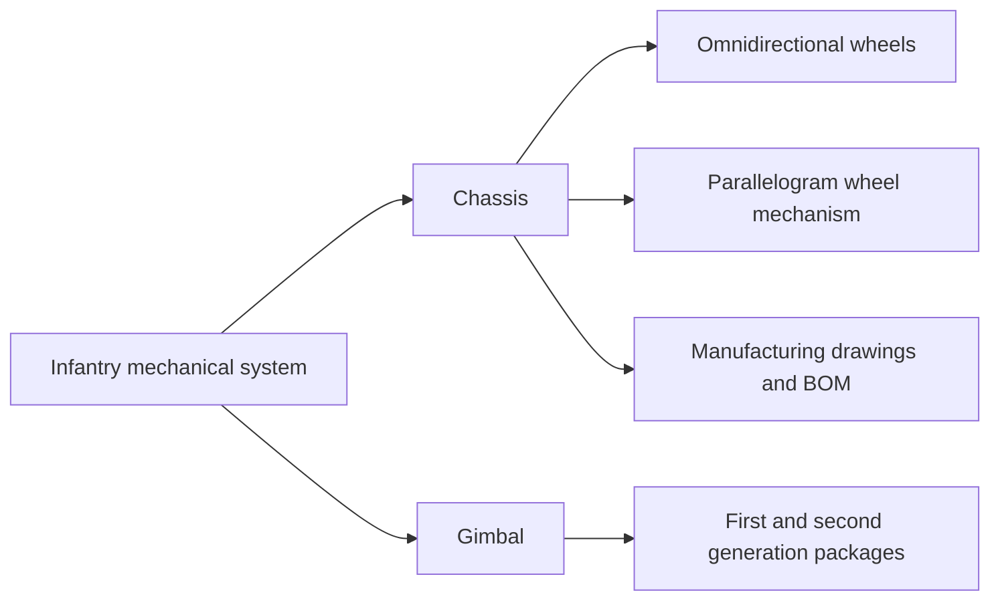

# RoboMaster Infantry Robot Mechanical Design Archive

Mechanical project materials from the local RM collection, organized for browsing and preservation. The archive contains first- and second-generation infantry chassis and gimbal assemblies, omnidirectional wheels, a parallelogram wheel mechanism, manufacturing drawings, bills of materials and historical test videos. Generation and event labels follow the original filenames; they are not verified release designations.

## Explore the robot

Start with the recorded [translation and turning demonstration](source/%E5%B9%B3%E5%9B%9B%E8%BD%AE%E7%B3%BB%E4%BF%AE%E6%94%B92.0/%E6%AD%A5%E5%85%B5%E7%BB%84%E4%B8%AD%E6%9C%9F%E8%B5%84%E6%96%99/%E6%AD%A5%E5%85%B5%E7%BB%84%E4%B8%AD%E6%9C%9F%E8%A7%86%E9%A2%91/%E5%AE%8C%E6%95%B4%E8%BF%90%E5%8A%A8%EF%BC%9A%E5%B9%B3%E7%A7%BB%E4%B8%8E%E8%BD%AC%E5%90%91.mp4) and [ramp demonstration](source/%E5%B9%B3%E5%9B%9B%E8%BD%AE%E7%B3%BB%E4%BF%AE%E6%94%B92.0/%E6%AD%A5%E5%85%B5%E7%BB%84%E4%B8%AD%E6%9C%9F%E8%B5%84%E6%96%99/%E6%AD%A5%E5%85%B5%E7%BB%84%E4%B8%AD%E6%9C%9F%E8%A7%86%E9%A2%91/%E7%88%AC15%C2%B0%E5%9D%A1%E4%B8%8E%E5%AE%9E%E6%97%B6%E5%8A%9F%E7%8E%87%E6%98%BE%E7%A4%BA.mp4). These are historical recordings; the ramp angle is taken from the source filename, not an independently measured result.

This is a navigation map of the archive, not a dimensioned assembly drawing.

| Interest | Suggested reading path |
| --- | --- |
| Robot motion | Recorded translation/turning and ramp videos → chassis packages |
| Mechanical mechanisms | Wheel and parallelogram assemblies → related parts |
| Design for manufacture | Manufacturing package → BOM → drawings |
| Historical testing | [Video/document index](docs/FILE_INDEX.md) → inspection and maintenance records |

The archive demonstrates the scope of the mechanical project through CAD, manufacturing files and recordings. It does not include verified firmware or a new performance benchmark. Supplier components and team materials retain their original context.

## Assembly packages

| Package / 材料包 | Directory / 文件夹 | Suggested entry / 建议入口 |
| --- | --- | --- |
| Second-generation competition assembly | [二代区域赛步兵装配](source/%E4%BA%8C%E4%BB%A3%E5%8C%BA%E5%9F%9F%E8%B5%9B%E6%AD%A5%E5%85%B5%E8%A3%85%E9%85%8D) | [二代省赛模型总装.SLDASM](source/%E4%BA%8C%E4%BB%A3%E5%8C%BA%E5%9F%9F%E8%B5%9B%E6%AD%A5%E5%85%B5%E8%A3%85%E9%85%8D/%E4%BA%8C%E4%BB%A3%E7%9C%81%E8%B5%9B%E6%A8%A1%E5%9E%8B%E6%80%BB%E8%A3%85.SLDASM) |
| Second-generation chassis | [二代步兵底盘](source/%E4%BA%8C%E4%BB%A3%E6%AD%A5%E5%85%B5%E5%BA%95%E7%9B%98) | [装配体-底盘总装.SLDASM](source/%E4%BA%8C%E4%BB%A3%E6%AD%A5%E5%85%B5%E5%BA%95%E7%9B%98/%E8%A3%85%E9%85%8D%E4%BD%93-%E5%BA%95%E7%9B%98%E6%80%BB%E8%A3%85.SLDASM) |
| Second-generation balancing infantry gimbal | [二代平衡步兵云台](source/%E4%BA%8C%E4%BB%A3%E5%B9%B3%E8%A1%A1%E6%AD%A5%E5%85%B5%E4%BA%91%E5%8F%B0) | [二代平衡步兵云台/二代平衡步兵云台.SLDASM](source/%E4%BA%8C%E4%BB%A3%E5%B9%B3%E8%A1%A1%E6%AD%A5%E5%85%B5%E4%BA%91%E5%8F%B0/%E4%BA%8C%E4%BB%A3%E5%B9%B3%E8%A1%A1%E6%AD%A5%E5%85%B5%E4%BA%91%E5%8F%B0/%E4%BA%8C%E4%BB%A3%E5%B9%B3%E8%A1%A1%E6%AD%A5%E5%85%B5%E4%BA%91%E5%8F%B0.SLDASM) |
| Manufacturing drawings and bills of materials | [二代区域赛步兵底盘配件归纳](source/%E4%BA%8C%E4%BB%A3%E5%8C%BA%E5%9F%9F%E8%B5%9B%E6%AD%A5%E5%85%B5%E5%BA%95%E7%9B%98%E9%85%8D%E4%BB%B6%E5%BD%92%E7%BA%B3) | See BOM and manufacturing drawings / 查看 BOM 及加工图 |
| First-generation chassis | [一代步兵底盘装配11.23](source/%E4%B8%80%E4%BB%A3%E6%AD%A5%E5%85%B5%E5%BA%95%E7%9B%98%E8%A3%85%E9%85%8D11.23) | [一代全向轮步兵底盘总装配.SLDASM](source/%E4%B8%80%E4%BB%A3%E6%AD%A5%E5%85%B5%E5%BA%95%E7%9B%98%E8%A3%85%E9%85%8D11.23/%E4%B8%80%E4%BB%A3%E5%85%A8%E5%90%91%E8%BD%AE%E6%AD%A5%E5%85%B5%E5%BA%95%E7%9B%98%E6%80%BB%E8%A3%85%E9%85%8D.SLDASM) |
| First-generation gimbal | [一代步兵云台装配11.23](source/%E4%B8%80%E4%BB%A3%E6%AD%A5%E5%85%B5%E4%BA%91%E5%8F%B0%E8%A3%85%E9%85%8D11.23) | [一代云台总装.SLDASM](source/%E4%B8%80%E4%BB%A3%E6%AD%A5%E5%85%B5%E4%BA%91%E5%8F%B0%E8%A3%85%E9%85%8D11.23/%E4%B8%80%E4%BB%A3%E4%BA%91%E5%8F%B0%E6%80%BB%E8%A3%85.SLDASM) |
| Parallelogram wheel mechanism and interim records | [平四轮系修改2.0](source/%E5%B9%B3%E5%9B%9B%E8%BD%AE%E7%B3%BB%E4%BF%AE%E6%94%B92.0) | [平行四边形轮系.SLDASM](source/%E5%B9%B3%E5%9B%9B%E8%BD%AE%E7%B3%BB%E4%BF%AE%E6%94%B92.0/%E5%B9%B3%E8%A1%8C%E5%9B%9B%E8%BE%B9%E5%BD%A2%E8%BD%AE%E7%B3%BB.SLDASM) |
| Omnidirectional wheel | [全向轮](source/%E5%85%A8%E5%90%91%E8%BD%AE) | [全向轮整体装配.SLDASM](source/%E5%85%A8%E5%90%91%E8%BD%AE/%E5%85%A8%E5%90%91%E8%BD%AE%E6%95%B4%E4%BD%93%E8%A3%85%E9%85%8D.SLDASM) |

The assembly entries above are identified from filenames, not confirmed by opening the CAD models. The competition package folder says “regional competition,” while its main assembly filename says “provincial competition”; both names are retained. No single version has been declared the final or preferred design.

- [Document and video index](docs/FILE_INDEX.md)

## Using the CAD files

Keep the complete `source` tree together. Do not rename CAD parts, flatten folders or merge same-named components across generations: assemblies may depend on those paths. The original internal directory structure, CAD filenames, material files and rendering textures are preserved. If SolidWorks requests references, locate them inside the corresponding source package; absolute references outside the supplied collection may still need manual repair. Native assemblies have not been opened, rebuilt or checked for missing references. The archive contains no identified firmware, control software or verified simulation project.

CAD files and videos use Git LFS. Install Git LFS before the first `git add`, and use `git lfs pull` after cloning to obtain the actual files. GitHub's ZIP download may contain pointers instead of LFS content, depending on the repository settings. See [GitHub's Git LFS documentation](https://docs.github.com/en/repositories/working-with-files/managing-large-files/about-git-large-file-storage).

---

# RoboMaster 步兵机器人机械设计资料

本目录整理 RM 原始材料，包含一、二代底盘和云台、全向轮、平行四边形轮系、加工图、BOM 及历史测试视频。代际和赛事名称沿用源文件，不代表已验证的正式发布版本。上表提供材料包和建议装配入口；检索入口根据文件名确定，未在 CAD 软件中确认。

“二代区域赛步兵装配”文件夹中的主装配名为“二代省赛模型总装”，两种名称均保留，未擅自指定某套模型为最终版。

## 使用说明

- 完整保留 `source` 目录，不要打散、重命名或跨代合并零件。同名文件可能属于不同设计版本。
- 装配体、零件、材质和贴图均保留原有相对目录。原文件中的绝对外部引用仍可能需要在 SolidWorks 中手动重定位；本次没有执行装配打开、重建及缺失引用验证。
- CAD 和视频采用 Git LFS。首次 `git add` 前先安装并启用 Git LFS；克隆后执行 `git lfs pull`。直接下载 ZIP 是否含实际大文件取决于仓库设置。
- 本次没有发现可确认的固件、控制程序或完整仿真工程。

## 中文阅读建议

先看上方“平移与转向”和“爬坡”视频入口，再按底盘、云台、轮系和加工资料选择材料包。结构关系图仅作导航，不是装配图。视频是历史记录，不能仅凭文件名把角度或性能视为已独立验证的数据。原始团队材料和供应商零件保留其来源背景。

Archive maintenance / 归档维护

[Preparation record](PREPARATION.md) · [Source manifest](SOURCE_MANIFEST.csv) · [Excluded-file inventory](EXCLUDED_FILES.csv) · [Original upload notes](UPLOAD.md)

